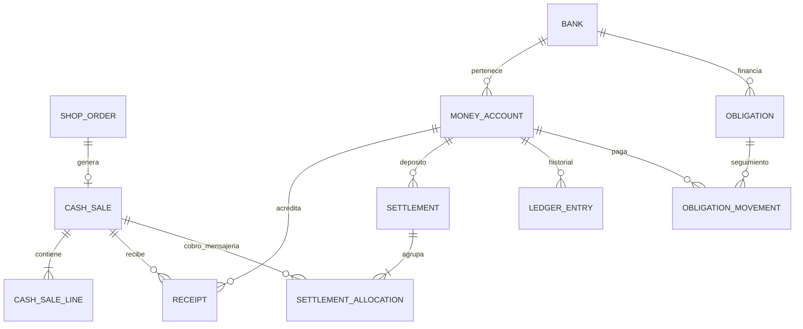

# Base de datos de Dirtytask en Supabase

`supabase.sql` es una instalación inicial para PostgreSQL 15 o posterior: **36 tablas, 8 vistas**, funciones RPC, claves foráneas, índices, auditoría, RLS y tres buckets. No importa los datos del navegador ni conecta automáticamente el frontend.

## Instalación

1. Crea un proyecto de Supabase y abre **SQL Editor** como administrador.
2. Ejecuta **todo `sql/supabase.sql`**. Se ejecuta en una transacción; si existe `dtshop`, aborta sin borrar datos. Para futuras versiones utiliza migraciones, no vuelvas a ejecutar la instalación.
3. Agrega `dtshop` a los esquemas expuestos en la configuración de Data API. **No expongas `dtshop_private`**. Supabase requiere configurar explícitamente los [esquemas personalizados](https://supabase.com/docs/guides/api/using-custom-schemas).
4. Crea o invita a los dos socios desde **Authentication → Users**, cada uno con su correo. Activa su rol con el SQL siguiente, sustituyendo ambos correos. Comprueba que retorna exactamente dos filas.
5. Prueba primero en un proyecto de desarrollo y conecta después los repositorios de datos del frontend.

**No ejecutes `sql/dirtytask.sql` para esta instalación:** es el esquema previo de PostgreSQL, tiene autenticación distinta e incluye borrado de esquema. Este archivo nuevo no lo modifica ni migra sus datos.

```sql
UPDATE dtshop.app_user AS profile
SET role = CASE
  WHEN account.email = 'operaciones@tu-tienda.com' THEN 'partner_ops'
  WHEN account.email = 'finanzas@tu-tienda.com' THEN 'partner_finance'
END
FROM auth.users AS account
WHERE profile.id = account.id
  AND account.email IN ('operaciones@tu-tienda.com', 'finanzas@tu-tienda.com')
RETURNING profile.id, account.email, profile.role;
```

Los usuarios nuevos son `customer`, incluso si intentan enviarse otro rol en sus metadatos. Hay como máximo un socio activo de cada rol. No se crean contraseñas ni usuarios de prueba.

## Cobertura y relaciones

| Área | Tablas principales y relaciones |
|---|---|
| Acceso | `auth.users → app_user`; roles individuales; `audit_event` conserva autor y valores anteriores/nuevos |
| Catálogo | `category → product → product_variant / product_media`; `inventory_movement` registra variaciones de stock |
| Lanzamientos | `launch ↔ product` mediante `launch_product` |
| Tienda | `store_setting`, `payment_method`, `department`, `content_block`, `content_video` |
| Clientes | `app_user → customer / cart / saved_product`; `cart → cart_item → product_variant` |
| Pedidos | `customer → shop_order → shop_order_line / order_status_event`; líneas conservan nombre, precio y condición de preventa; pedido conserva moneda |
| Ventas | `shop_order → cash_sale` opcional; `cash_sale → cash_sale_line / cash_sale_adjustment / receipt` |
| Cuentas y caja | `bank → money_account → ledger_entry / account_reconciliation`; `account_transfer` vincula origen y destino |
| Mensajería | `settlement ↔ cash_sale` mediante `settlement_allocation`; depósito confirmado entra en una cuenta |
| Deudas | `bank → obligation → obligation_movement`; pagos vinculan la cuenta debitada |
| Comprobantes | `attachment` referencia el archivo privado y se vincula con cobros, gastos, ingresos, transferencias, liquidaciones, pagos y cuadres |
| Aprobaciones | `operation_request` conserva payload, solicitante, revisor, estado, resultado e idempotencia |



## Permisos y funcionamiento

Ambos socios pueden leer la administración y contabilidad. Operaciones modifica catálogo, crea ventas y actualiza pedidos. Finanzas prepara movimientos financieros. Operaciones también puede solicitar cobros, ajustes de venta y liquidaciones pendientes. **Cada solicitud financiera necesita la aprobación del otro socio**, incluidos movimientos pequeños; es la regla inicial conservadora, modificable con una migración si acuerdan otro flujo.

Las ventas no implican pago. Un anticipo es un `receipt` parcial; cada pago posterior puede ingresar en una cuenta distinta o en caja. Ajustar el total genera `cash_sale_adjustment`, no un cobro. El servidor impide cobrar por encima del total vigente, duplicar aprobaciones o dejar saldos históricos negativos.

Forza acepta una venta por liquidación; Fast Delivery permite una o varias. La venta deja de estar pendiente del cliente al registrar su cobro por mensajería, y queda pendiente de la mensajería hasta confirmar el depósito. El depósito neto entra **una sola vez** al libro; retenciones y ajustes quedan desglosados por venta sin descontarlos otra vez de la cuenta.

Una cuota puede registrarse únicamente con su monto total. Sin desglose ni saldo bancario, no se inventa cuánto amortizó: el saldo queda pendiente de actualización. Un movimiento `statement` registra posteriormente el saldo informado por el banco, con importe cero y sin debitar ninguna cuenta. `principal` reduce capital; `purchase` y `charge` aumentan deuda exclusivamente en tarjetas. Opcionalmente se admite un desglose real en `payment` con `principal_known=true`.

Los movimientos confirmados son inmutables. `reverse_manual` permite contrapartidas de ingresos/gastos manuales, una sola vez. Las devoluciones de ventas y anulaciones de cobros vinculados necesitan un flujo adicional de backend; no se deben resolver borrando filas. Un cuadre revisado cierra esa cuenta hasta la fecha indicada: las correcciones posteriores usan una fecha posterior.

RLS protege las tablas y las vistas ejecutan con permisos del solicitante. Las funciones internas no tienen permiso de ejecución para clientes. Referencia: [RLS en Supabase](https://supabase.com/docs/guides/database/postgres/row-level-security).

## Integración del frontend

Usa el cliente de Supabase autenticado y selecciona el esquema:

```js
const db = supabase.schema('dtshop');
const { data, error } = await db.from('v_account_balances').select('*');
```

Las cantidades se transmiten como **centavos enteros** (`10000` significa Q100.00); monedas GTQ/USD nunca se suman entre sí. Conserva los UUID. Las fechas de negocio usan `America/Guatemala`; los tiempos de auditoría son `timestamptz`.

Crear una venta externa:

```js
const { data: saleId, error } = await db.rpc('create_sale', { p: {
  reference: 'VENTA-001', business_date: '2026-11-03',
  channel: 'external', currency: 'GTQ', customer_name: 'Cliente',
  shipping_mode: 'extra', shipping_cents: 3500,
  lines: [{ name: 'Prenda', qty: 1, unit_price_cents: 10000 }]
}});
```

Solicitar un anticipo y, con la sesión del otro socio, aprobarlo:

```js
const key = crypto.randomUUID(); // conservar esta misma clave en reintentos
const { data: requestId } = await db.rpc('submit_operation', {
  p_operation: 'receipt', p_idempotency_key: key,
  p_payload: { sale_id: saleId, account_id: accountId,
    business_date: '2026-11-03', amount_cents: 5000,
    reference: 'Depósito', attachment_id: attachmentId }
});
// Otro socio, otra sesión:
await db.rpc('review_operation', {
  p_request: requestId, p_approve: true, p_note: 'Depósito verificado'
});
```

Adapta las fechas de los ejemplos al movimiento real. Las claves de idempotencia se aplican a solicitudes financieras; utiliza referencias únicas para evitar ventas repetidas. `create_sale` con `shop_order_id` copia precios y moneda del pedido. Las ventas físicas/externas con `product_id` descuentan stock, excepto preventas.

### Operaciones financieras disponibles

Todas pasan por `submit_operation` y `review_operation`. Los campos con sufijo `_id` son UUID salvo identificadores del catálogo/lanzamientos, que son texto.

| Operación | Campos principales del payload |
|---|---|
| `account_open` | name, account_type (`bank/cash`), bank_name, reference_last4, currency, opening_balance_cents, opened_on |
| `obligation_open` | bank_name, reference, name, obligation_type (`loan/financing/card`), currency, opening_balance_cents, installment_cents, due_day, start_date |
| `receipt` | sale_id, account_id, business_date, amount_cents, reference, attachment_id opcional |
| `income` / `expense` | account_id, business_date, amount_cents, category, concept, attachment_id opcional |
| `transfer` | from_account_id, to_account_id, business_date, amount_cents, concept, attachment_id opcional |
| `sale_adjustment` | sale_id, business_date, amount_cents con signo, reason |
| `settlement_open` | courier (`Forza/Fast Delivery`), business_date, currency, reference, allocations: [{sale_id, amount_cents}] |
| `settlement_confirm` | settlement_id, account_id, confirmed_on, received_cents, service_cents, commission_cents, discount_cents, adjustment_cents, reason, attachment_id opcional |
| `obligation_movement` | obligation_id, movement_type, business_date, total_cents, account_id para pagos, period_month para cuota, statement_balance_cents opcional, attachment_id opcional |
| `reverse_manual` | entry_id, business_date, reason, attachment_id opcional |

Categorías de ingreso: `operating`, `contribution`, `financing`; de gasto: `advertising`, `delivery`, `supplies`, `other`. `period_month` usa el primer día del mes. Para actualizar saldo: `movement_type:'statement'`, `total_cents:0`, `statement_balance_cents` obligatorio, sin cuenta. `adjustment_cents` de mensajería es positivo; deducciones adicionales van en `discount_cents`, ambos con motivo.

Otros RPC: `register_attachment`, `prepare_reconciliation`, `review_reconciliation`, `set_order_status`, `place_order`. Las firmas y validaciones completas están en el SQL.

### Archivos

| Bucket | Acceso | Límite |
|---|---|---|
| `dtshop-products` | Lectura pública, subida por operaciones | 15 MB, imágenes |
| `dtshop-receipts` | Lectura/subida de socios; sin reemplazo ni eliminación desde cliente | 5 MB, JPG/PNG/WebP/PDF |
| `dtshop-avatars` | Propietario y socios pueden leer; propietario sube | 2 MB, imágenes |

Sube mediante Storage API con ruta `<auth.uid()>/<uuid>/<archivo>`. Para comprobantes, después llama `register_attachment(p_key,p_name,p_type,p_bytes)` y vincula el UUID devuelto al movimiento. Genera una URL firmada al visualizar archivos privados, no guardes esa URL temporal en la base. El SQL comprueba existencia/ruta; MIME y tamaño declarados no sustituyen la validación del archivo por Storage/backend. Referencia: [control de acceso de Storage](https://supabase.com/docs/guides/storage/security/access-control).

### Checkout y backend futuro

`place_order` calcula precios/envío desde la base, verifica variantes y stock y guarda el pedido. No crea automáticamente una venta ni un cobro. Clientes autenticados pueden invocarlo; visitantes requieren un endpoint/Edge Function con validación y protección contra abuso. La clave `service_role` es exclusiva del servidor, nunca del navegador. Aún debes integrar Supabase Auth, las llamadas RPC y la subida de archivos con las pantallas actuales.

## BI y validación

Vistas: `v_account_ledger`, `v_account_balances`, `v_sale_balances`, `v_obligation_balances`, `v_cash_daily`, `v_cash_weekly`, `v_cash_monthly`, `v_settlement_costs`.

Las vistas de caja muestran entradas/salidas reales, excluyen transferencias internas y separan monedas. **Flujo de caja no equivale a utilidad**: aportes y financiamiento son entradas; amortización es salida; el cálculo de utilidad necesitará además costos de mercancía y criterios contables. Los datos conservan categorías y relaciones para ese análisis futuro. El aspecto de libro en papel corresponde al frontend; `v_account_ledger` aporta el historial con saldo acumulado.

Prueba automatizada: `tests/supabase.cjs`, con PostgreSQL embebido PGlite y esquemas simulados de Auth/Storage. Comprueba instalación, permisos, aprobaciones, idempotencia, anticipos, sobrecobro, sobregiro, reversión, liquidaciones, transferencias, saldo bancario, checkout, stock, comprobantes y cierre. No sustituye una prueba de Auth/Storage/Data API en Supabase alojado.

```powershell
npm.cmd install --prefix "$env:TEMP/ditshop-sql-validation" --no-audit --no-fund @electric-sql/pglite
$env:PGLITE_MODULE = "$env:TEMP/ditshop-sql-validation/node_modules/@electric-sql/pglite"
node tests/supabase.cjs
```

Los registros de las pruebas viven solo en la base temporal de PGlite. El script de instalación incluye únicamente departamentos, categorías, configuración, métodos de pago y textos iniciales.
